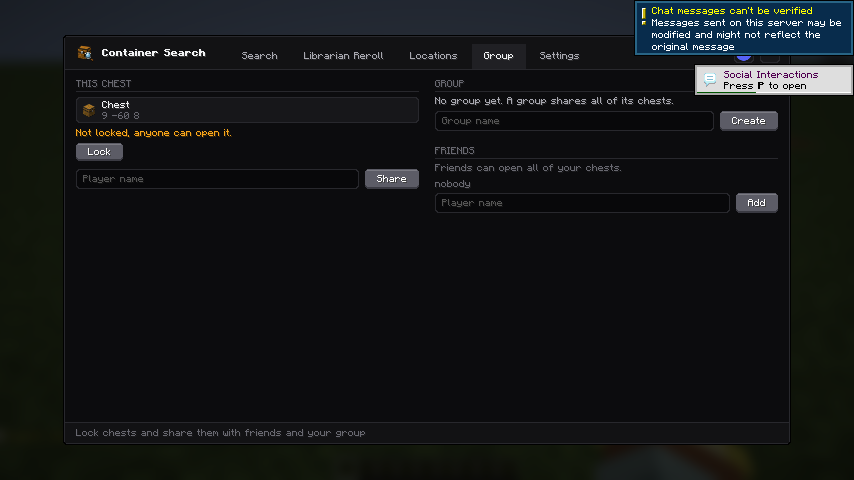
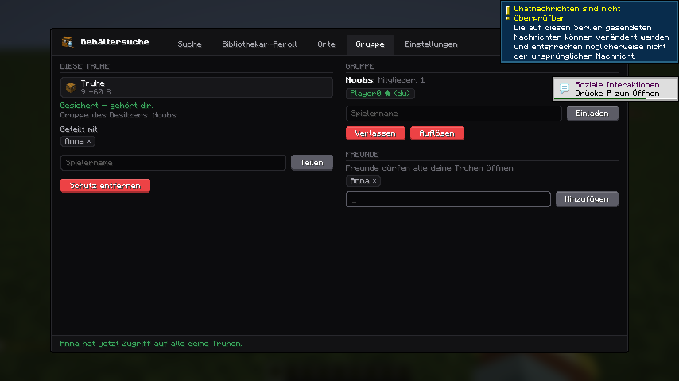

# Noobs-Container-Searcher – Server-Plugin

PaperMC-Plugin: Truhen sichern und mit anderen Spielern, Freunden und Gruppen teilen.
Läuft auf Paper **1.21.x und 26.x** (Java 21+, getestet auf 1.21.11 und 26.3).

Passender Client-Mod mit Bedienung per Klick statt Befehlen:
[glandit/Noobs-Container-Searcher, Branch `truhenschutz`](https://github.com/glandit/Noobs-Container-Searcher/tree/truhenschutz)
(Fork von [nooobfly/Noobs-Container-Searcher](https://github.com/nooobfly/Noobs-Container-Searcher)).
Das Plugin funktioniert auch ohne Mod – dann über Befehle.

## Download & Installation
- **Plugin:** [Releases](https://github.com/glandit/Noobs-Container-Searcher-Plugin/releases) →
  `Noobs-Container-Searcher-1.1.0.jar` in den `plugins/`-Ordner legen, Server neu starten.
- **Mod (optional, für die Spieler):** [Mod-Releases](https://github.com/glandit/Noobs-Container-Searcher/releases) →
  Jar passend zu Minecraft-Version und Loader (Fabric oder NeoForge) in den `mods/`-Ordner.

## So funktioniert's
- Neue Truhe/Fass platzieren → automatisch **deine** (nur du kannst öffnen & abbauen).
- Truhe anschauen und Befehl eingeben:

| Befehl | Wirkung |
|---|---|
| `/truhe teilen <Spieler>` | Diese Truhe mit Spieler teilen |
| `/truhe entziehen <Spieler>` | Zugriff wieder wegnehmen |
| `/truhe info` | Besitzer & Freigaben anzeigen |
| `/truhe sperren` / `entsperren` | Schutz an / aus |
| `/truhe vertrauen <Spieler>` | Freund: Zugriff auf **alle** deine Truhen |
| `/truhe misstrauen <Spieler>` | Freund entfernen |
| `/truhe freunde` | Freundesliste |
| `/truhe reload` | Config neu laden (Admin) |

## Gruppen – alle teilen alles
In einer Gruppe hat **jedes Mitglied Zugriff auf alle Truhen aller anderen Mitglieder** –
auch auf Truhen, die erst später gebaut werden.

| Befehl | Wirkung |
|---|---|
| `/gruppe erstellen <Name>` | Gruppe gründen (du bist Anführer) |
| `/gruppe einladen <Spieler>` | Spieler einladen (nur Anführer, Spieler muss online sein) |
| `/gruppe annehmen` / `ablehnen` | Einladung beantworten (oder im Chat anklicken) |
| `/gruppe info` | Mitglieder anzeigen (grün = online) |
| `/gruppe verlassen` | Gruppe verlassen (Anführer geht → nächstes Mitglied übernimmt) |
| `/gruppe entfernen <Spieler>` | Mitglied rauswerfen (nur Anführer) |
| `/gruppe auflösen` | Gruppe löschen (nur Anführer) |

Jeder Spieler kann in einer Gruppe sein. Beitritt nur per Einladung.
Mitglieder dürfen Gruppen-Truhen auch abbauen – abschaltbar mit `groups.members-can-break: false`.

## Truhen-Sync unter Freunden
Mit dem Client-Mod (Branch `truhenschutz`) kennen Freunde und Gruppenmitglieder die Truhen der anderen,
ohne sie selbst geöffnet zu haben: **Wer eine Truhe öffnet, schickt ihren Inhalt an alle Freunde, die sie öffnen dürfen.**
- **Freunde** sind Spieler, bei denen einer dem anderen vertraut (`/truhe vertrauen`) oder die in derselben Gruppe sind.
- Empfänger bekommen den Stand nur, wenn sie die Truhe selbst öffnen dürften (ungesichert, Besitzer, geteilt, Freund
  des Besitzers, Gruppe des Besitzers).
- Der Server prüft, dass der Absender die Truhe öffnen darf und in der Nähe steht, und merkt sich den letzten Stand
  (`plugins/Noobs-Container-Searcher/sync.json`). Wer später beitritt, bekommt ihn nachgeschickt. Beim Abbau wird er gelöscht.
- Der Inhalt wird vom Mod gepackt (JSON, gzip, base64); der Server leitet ihn nur weiter und liest ihn nicht.
- Ein Spieler kann das im Mod abschalten (`shareWithFriends` in `config/noobs-container-searcher/settings.json`).
- Server-Schalter: `sync.enabled` und `sync.max-entries` in der `config.yml`.

## Bedienung im Mod „Noob's Container Searcher“ (statt Befehlen)
Wer den Client-Mod hat, bekommt im Fenster (Taste `G`) einen Tab **„Gruppe“** –
aber nur auf Servern mit diesem Plugin:
- **Diese Truhe:** Truhe anschauen, `G` drücken → Besitzer sehen, sichern, teilen (Name eintippen
  oder auf `+ Name` klicken), Freigabe per ✕ entziehen, Schutz entfernen.
- **Gruppe:** gründen, einladen (`+ Name`), Einladung annehmen/ablehnen, Mitglieder (grün = online,
  ★ = Anführer), rauswerfen, verlassen, auflösen.
- **Freunde:** Spieler, die alle deine Truhen öffnen dürfen.

Technik: Kanal `noobs_container_searcher:protect`, JSON-Nachrichten (siehe `ModChannel.java`).
Der Server prüft jede Aktion selbst – der Mod ist nur die Oberfläche.

| Truhe noch ungesichert (Englisch) | Gesichert, Gruppe, geteilt, Freund (Deutsch) |
|---|---|
|  |  |

Aliase: `/ncs`, `/kiste`. Englisch geht auch: `share`, `unshare`, `lock`, `unlock`, `trust`, `untrust`.

## Schutz
- Geteilte Spieler dürfen öffnen, **nicht** abbauen.
- Doppeltruhen: beide Hälften geschützt; fremde Truhe erweitern geht nicht.
- Explosionen & Wither zerstören gesicherte Truhen nicht.
- Trichter ziehen nur aus gesicherten Truhen, wenn ein Spieler mit Zugriff sie gesetzt hat.
  Trichterloren werden blockiert. (Alte Trichter von vor der Installation: einmal neu setzen.)

## Sprachen
Jeder Spieler bekommt die Texte in **seiner Spielsprache** – wie beim Mod:
Englisch, Deutsch, Portugiesisch (BR), Russisch, Türkisch. Andere Sprachen → Englisch.
- `config.yml` → `language: auto` (Standard) oder fest z.B. `language: de_de`
- Texte anpassen: `plugins/Noobs-Container-Searcher/lang/<sprache>.yml`
- Neue Sprache: einfach z.B. `fr_fr.yml` dort ablegen
- Befehle gibt es deutsch und englisch: `/truhe teilen` = `/ncs share`, `/gruppe einladen` = `/group invite`.
  Die Tab-Vervollständigung schlägt je nach Spielsprache deutsche oder englische Befehle vor.

## Rechte
- `ncs.use` – Truhen sichern & teilen (Standard: alle)
- `ncs.admin` – alle Truhen öffnen/abbauen/verwalten (Standard: OP)

## Selbst bauen
```
./gradlew build
```
Jar liegt dann in `build/libs/`. Gradle lädt bei Bedarf selbst ein passendes JDK 21 herunter.
Die Tests (MockBukkit) laufen beim Build mit.

## Lizenz
MIT – siehe [LICENSE](LICENSE).
