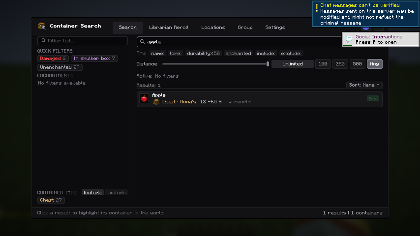
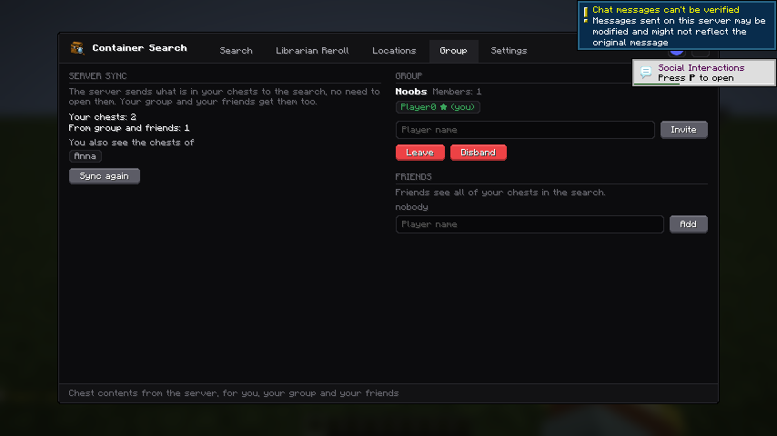

# Noobs-Container-Searcher – Server-Plugin

PaperMC-Plugin für den Client-Mod „Noob's Container Searcher“: Der Server merkt sich, was in deinen Truhen
liegt, und schickt es in die Suche des Mods – **ohne dass du die Truhen öffnen musst**.
Deine Gruppe und deine Freunde bekommen deine Truhen ebenfalls in ihre Suche.
Läuft auf Paper **1.21.x und 26.x** (Java 21+, getestet auf 26.3).

Passender Client-Mod:
[glandit/Noobs-Container-Searcher, Branch `truhenschutz`](https://github.com/glandit/Noobs-Container-Searcher/tree/truhenschutz)
(Fork von [nooobfly/Noobs-Container-Searcher](https://github.com/nooobfly/Noobs-Container-Searcher)).
Ohne Mod funktionieren nur die Befehle; die Kisteninhalte sieht man nur mit Mod.

**Geschützt wird nichts.** Alle können alle Truhen öffnen und abbauen, wie in Vanilla.
Besitz und Gruppen bestimmen nur, wer welche Inhalte in seiner Suche sieht.

## Download & Installation
1. Plugin-Jar unter [Releases](https://github.com/glandit/Noobs-Container-Searcher-Plugin/releases) herunterladen.
2. In den `plugins/`-Ordner des Servers legen und den Server neu starten.
3. Spieler installieren den passenden Mod
   ([Mod-Releases](https://github.com/glandit/Noobs-Container-Searcher/releases)).

## Welche Truhen gehören mir?
- Neue Truhen, Fässer und Shulkerkisten gehören dem, der sie **platziert**.
- Truhen von vor der Installation (und Loot-Truhen) gehören dem, der sie **als Erster öffnet**.
  Abschaltbar mit `claim-on-first-open: false`.
- Wird eine Truhe zur Doppeltruhe erweitert, behält sie ihren Besitzer.

## Wer sieht was?
| Wer | sieht in der Suche |
|---|---|
| Du | alle deine Truhen |
| Deine Gruppe | alle Truhen aller Mitglieder |
| Deine Freunde (`/ncs trust`) | alle deine Truhen – aber du nicht automatisch ihre |

Der Server liest den Inhalt neu ein, sobald sich etwas ändert: Spieler legt etwas rein oder nimmt raus,
Trichter schiebt Items, Truhe wird abgebaut oder explodiert. Die Änderung landet sofort in der Suche aller,
die die Truhe sehen dürfen. Der Stand bleibt auch über Neustarts erhalten (`containers.json.gz`).
Verlässt jemand die Gruppe oder wird als Freund entfernt, verschwinden die fremden Truhen aus seiner Suche.

## Befehle
| Befehl | Wirkung |
|---|---|
| `/truhe info` | Besitzer der angeschauten Truhe |
| `/truhe vertrauen <Spieler>` | Freund sieht alle deine Truhen |
| `/truhe misstrauen <Spieler>` | Freund entfernen |
| `/truhe freunde` | Freundesliste |
| `/truhe reload` | Config neu laden (Admin) |
| `/gruppe erstellen <Name>` | Gruppe gründen (du bist Anführer) |
| `/gruppe einladen <Spieler>` | Spieler einladen (nur Anführer, Spieler muss online sein) |
| `/gruppe annehmen` / `ablehnen` | Einladung beantworten (oder im Chat anklicken) |
| `/gruppe info` | Mitglieder anzeigen (grün = online) |
| `/gruppe verlassen` | Gruppe verlassen (Anführer geht → nächstes Mitglied übernimmt) |
| `/gruppe entfernen <Spieler>` | Mitglied rauswerfen (nur Anführer) |
| `/gruppe auflösen` | Gruppe löschen (nur Anführer) |

Aliase: `/ncs`, `/kiste` und `/group`. Englisch geht auch: `/ncs trust`, `/group invite` usw.

## Im Mod
Im Fenster des Mods (Taste `G`) gibt es auf Servern mit diesem Plugin den Tab **„Gruppe“**:
- **Server-Sync:** wie viele eigene und fremde Truhen der Server geschickt hat, von wem du Truhen siehst,
  Knopf „Neu laden“.
- **Gruppe:** gründen, einladen (`+ Name`), Einladung annehmen/ablehnen, Mitglieder (grün = online,
  ★ = Anführer), rauswerfen, verlassen, auflösen.
- **Freunde:** Spieler, die alle deine Truhen sehen.

In den Suchergebnissen steht bei fremden Truhen, wem sie gehören (z.B. „Truhe von Anna“).





Technik: Kanal `noobs_container_searcher:protect`, JSON-Nachrichten (siehe `ModChannel.java`).
Items gehen als `ItemStack#serializeAsBytes` (Base64) raus, der Mod liest sie mit dem Vanilla-Item-Codec.
Lange Nachrichten werden in Stücke unter 64 000 Zeichen geteilt.

## Konfiguration (`config.yml`)
- `tracked-blocks` – welche Blöcke gesynct werden (Standard: Truhe, Redstone-Truhe, Fass, alle Shulkerkisten)
- `claim-on-first-open` – alte Truhen gehören dem ersten, der sie öffnet (Standard: `true`)
- `language` – `auto` (Spielsprache jedes Spielers) oder fest, z.B. `de_de`
- `groups.invite-seconds` – wie lange eine Einladung gilt

## Sprachen
Jeder Spieler bekommt die Texte in **seiner Spielsprache** – wie beim Mod:
Englisch, Deutsch, Portugiesisch (BR), Russisch, Türkisch. Andere Sprachen → Englisch.
- Texte anpassen: `plugins/Noobs-Container-Searcher/lang/<sprache>.yml`
- Neue Sprache: einfach z.B. `fr_fr.yml` dort ablegen
- Nach einem Update mit geänderten Texten wird die alte Datei als `<sprache>.yml.old` gesichert.

## Rechte
- `ncs.use` – Befehle nutzen (Standard: alle)
- `ncs.admin` – volle `/ncs info` bei allen Truhen, `/ncs reload` (Standard: OP)

## Selbst bauen
```
./gradlew build
```
Jar liegt dann in `build/libs/`. Gradle lädt bei Bedarf selbst ein passendes JDK 21 herunter.
Die Tests (MockBukkit) laufen beim Build mit.

## Lizenz
MIT – siehe [LICENSE](LICENSE).
